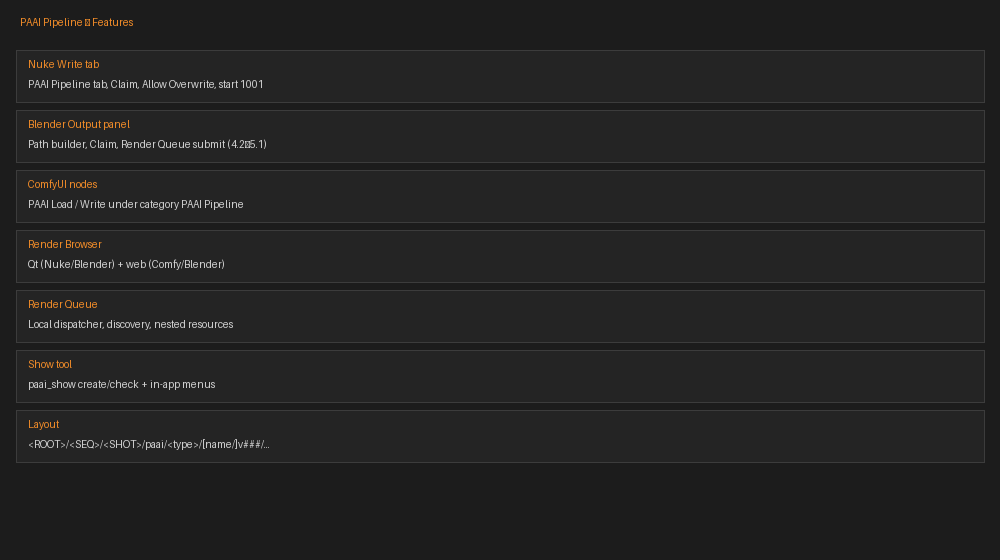
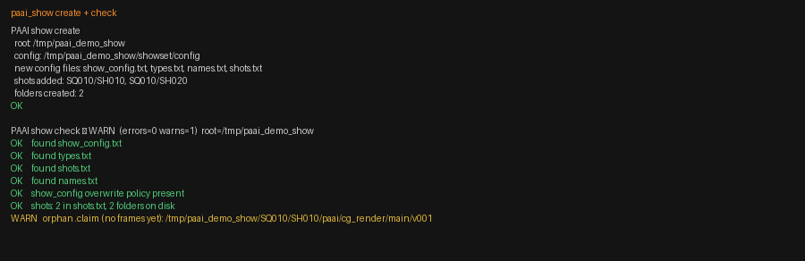
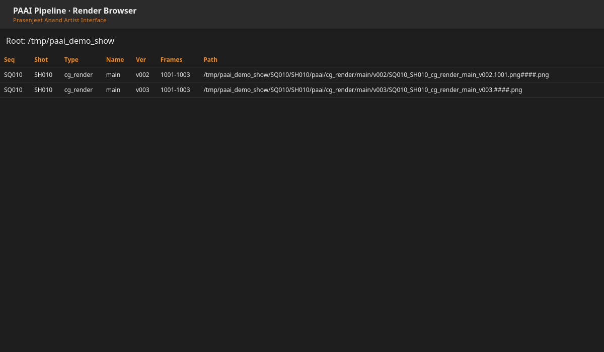
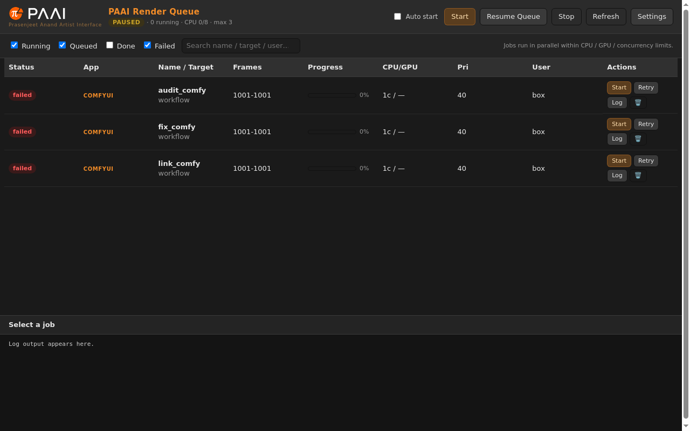

<p align="center">
  
</p>

# PAAI — Prasenjeet Anand Artist Interface
`This pipeline is designed for home studios, independent creators, and small teams, rather than large-scale productions. `
**PAAI Pipeline** is a small multi-app VFX pipeline for **Nuke**, **Blender**, and **ComfyUI**, plus a local **Render Queue**. Artists share one show folder layout, one versioning scheme (`v###` + optional Claim), and one browser/queue workflow—without requiring the queue Python package on each DCC’s `sys.path`.

## Features

- Shared show layout and `showset/config` (types, shots, names, start frame 1001)
- Nuke **PAAI Pipeline** Write tab · Blender Output panel (4.2–5.1) · ComfyUI **PAAI Load/Write**
- Render Browser (Qt + web) · Render Queue with port fallback and discovery files
- `paai_queue_link` (stdlib HTTP) · `paai_show` create/check (CLI + in-app)
- Atomic version Claim · overwrite guards · unified `version_note.json`



| | |
|--|--|
|  |  |
|  |  |

## Folder / filename layout

```text
<ROOT>/<SEQ>/<SHOT>/paai/<type>/[<name>/]v###/<SEQ>_<SHOT>_<type>[_<name>]_v###.####.<ext>
```

Example: `SHOW/SQ010/SH010/paai/cg_render/main/v003/SQ010_SH010_cg_render_main_v003.1001.exr`

## Quick install

Build install zips (or use a GitHub Release):

```bash
python release/build_release.py    # → dist/*.zip
```

| App | Zip | Install |
|-----|-----|---------|
| Render Queue | `paai_render_queue.zip` | Unzip · `run_queue.bat` / `python -m paai_render_queue` |
| Nuke 13–17 | `nuke_paai_pipeline.zip` (**flat**) | Extract all files into `~/.nuke` |
| Blender 4.2–5.1 | `blender_paai_pipeline.zip` | Preferences → Add-ons → Install |
| ComfyUI | `comfyui_paai_pipeline.zip` | Drop into `custom_nodes/` · see [DEPENDENCIES](docs/DEPENDENCIES.md) |

Show tree:

```bash
python tools/paai_show.py create --root /path/to/SHOW --seq SQ010 --shots SH010,SH020
python tools/paai_show.py check  --root /path/to/SHOW
```

## Docs

- [INSTALL.md](docs/INSTALL.md)
- [DEPENDENCIES.md](docs/DEPENDENCIES.md)
- [SHOW_SETUP.md](docs/SHOW_SETUP.md)
- [TUTORIAL.md](docs/TUTORIAL.md) (screenshots: real vs mockup labeled)
- [NAMING.md](docs/NAMING.md)

## Repo layout

```text
paai-pipeline/
  nuke/                          # flat Nuke pack
  blender/blender_paai_pipeline/
  comfyui/comfyui_paai_pipeline/
  render_queue/paai_render_queue/
  tools/paai_show.py
  docs/
  release/build_release.py
```

## Push to GitHub

This repo is initialized locally with no remote. To publish:

```bash
# create an empty GitHub repo first (website), then:
git remote add origin git@github.com:YOUR_USER/paai-pipeline.git
git push -u origin main

# or with GitHub CLI:
gh repo create paai-pipeline --public --source=. --remote=origin --push
```

## License

MIT © 2026 Prasenjeet Anand — see [LICENSE](LICENSE).
