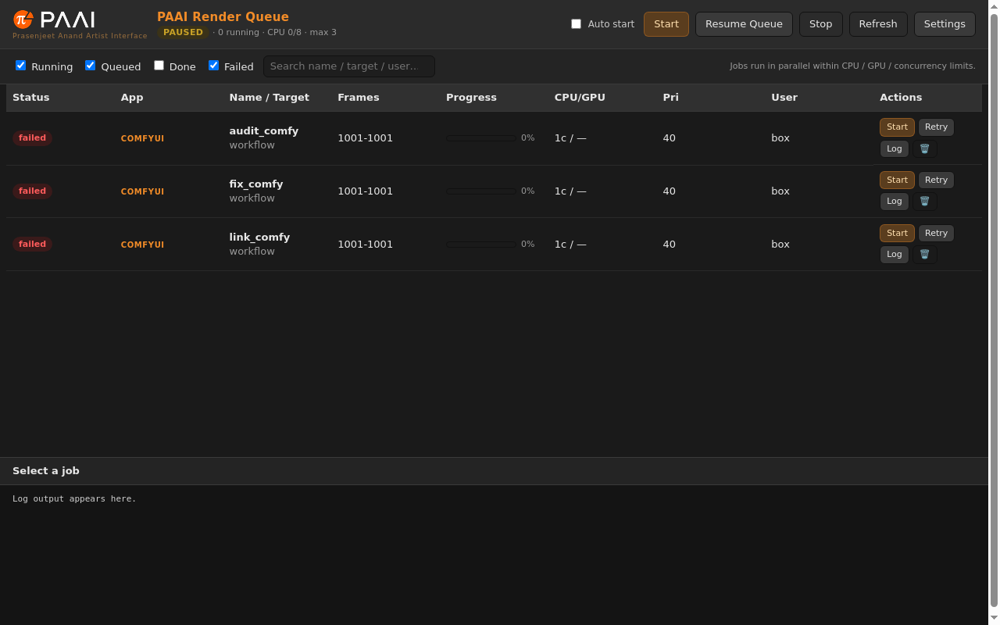
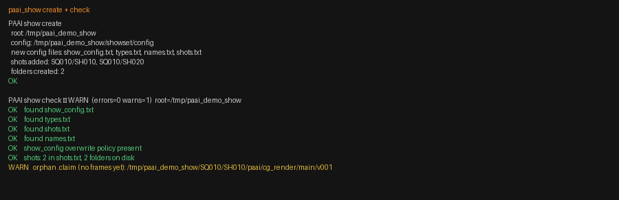
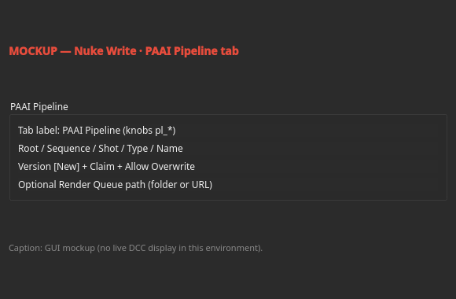
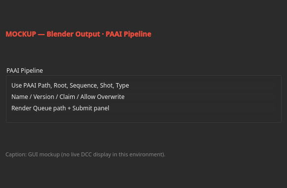
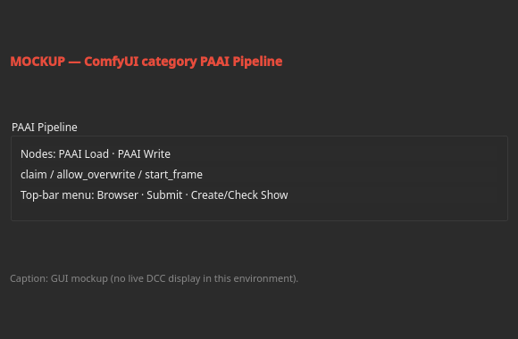
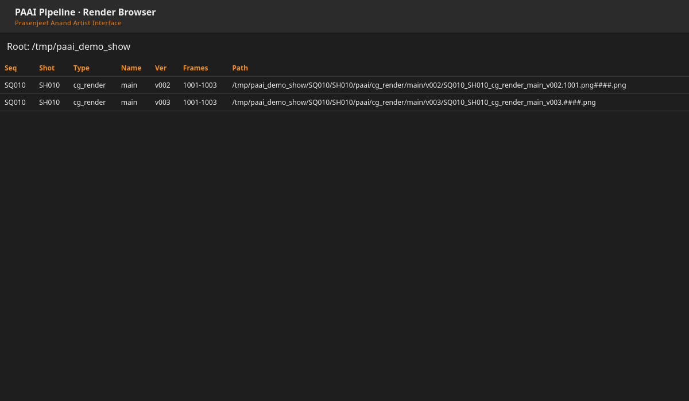
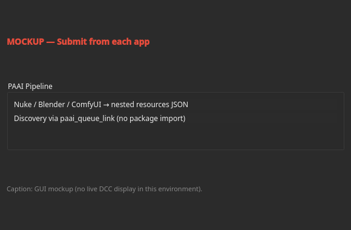
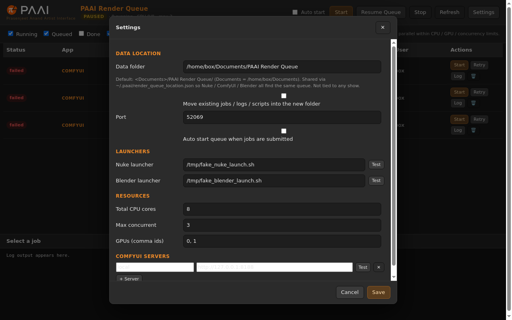
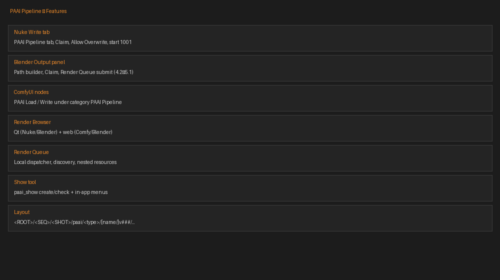

# Tutorial

Walkthrough with screenshots under `docs/images/`.

| Step | Image | Capture |
|------|-------|---------|
| Features overview | `00_features_overview.png` | Generated overview |
| 1. Queue install / home | `01_queue_home.png` | **Real** Render Queue web UI |
| 2. Create / check show | `02_paai_show_terminal.png` | **Real** terminal output rendered to image |
| 3. Nuke Write tab | `03_nuke_write_tab.png` | **MOCKUP** |
| 4. Blender Output panel | `04_blender_output_panel.png` | **MOCKUP** |
| 5. ComfyUI PAAI Write | `05_comfy_write_node.png` | **MOCKUP** |
| 6. Render Browser | `06_render_browser.png` | **Real** browser view of scanned demo show |
| 7. Submit from apps | `07_submit_from_apps.png` | **MOCKUP** |
| 8. Queue running jobs | `08_queue_running.png` | **Real** queue UI (after live Blender jobs) |
| 9. Queue Settings | `09_queue_settings.png` | **Real** Settings page |

---

## 1. Install the Render Queue

Unzip `paai_render_queue.zip`, run `run_queue.bat` / `run_queue.sh`, open the printed URL.



## 2. Create the show

```bash
python tools/paai_show.py create --root /path/to/SHOW --seq SQ010 --shots SH010,SH020
python tools/paai_show.py check --root /path/to/SHOW
```



## 3. Nuke Write — PAAI Pipeline tab

*MOCKUP — Nuke GUI not available in the build environment.*



## 4. Blender Output panel

*MOCKUP — Blender GUI screenshot.*



## 5. ComfyUI PAAI Write

*MOCKUP — ComfyUI GUI screenshot.*



## 6. Render Browser

Real browser capture of versions under a demo show (same data the in-app browsers scan).



## 7. Submit from each app

*MOCKUP — summary of Nuke / Blender / ComfyUI submitters.*



## 8. Queue running jobs

Real queue UI after submitting Blender jobs (`demo_show_job` completed in testing).


## 9. Queue Settings

Real Settings view (data folder, port, launchers, concurrency).



## Features overview


